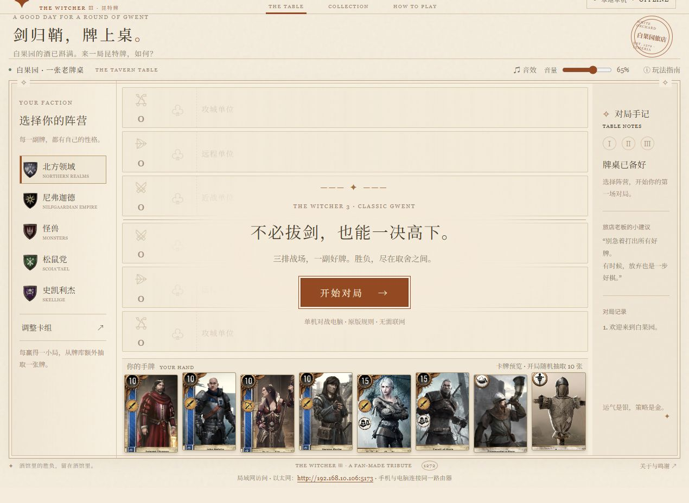
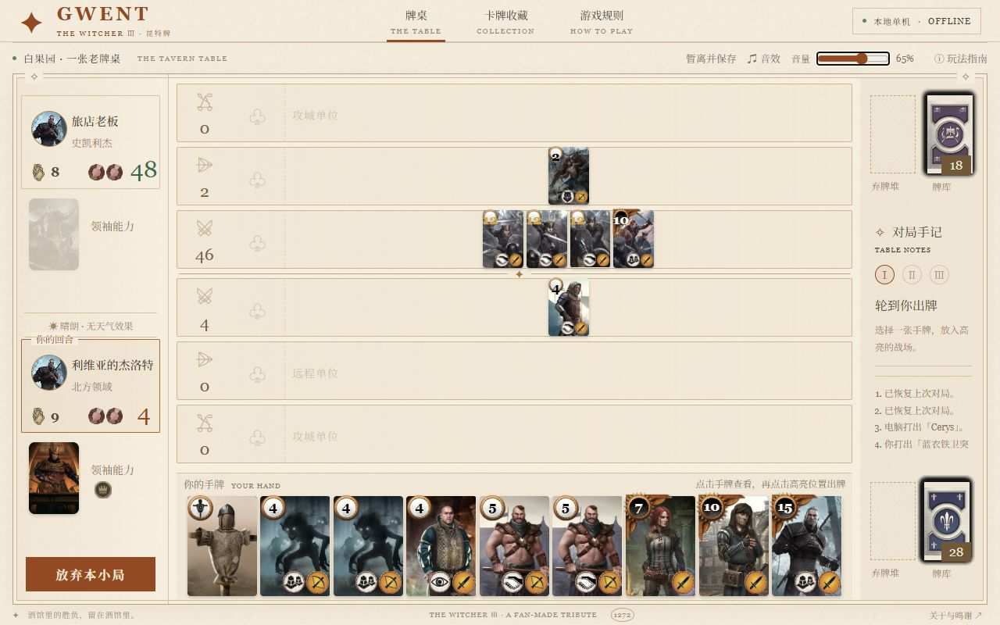

# 白果园旅店 · 昆特牌

《巫师 3：狂猎》内置昆特牌小游戏的本地浏览器版本。复古纸色界面、三排战场、五大阵营，支持单机对战电脑、局域网双人、暂离续玩与音量调节。卡图和音效均在本地，无需互联网。

## 界面展示

阵营选择与首页：



对战电脑，查看手牌、战力与对局记录：



## 环境配置

| 项目 | 要求 |
| --- | --- |
| 系统 | Windows / Linux / macOS |
| 运行环境 | Node.js 18 或更新版本，含 npm |
| 浏览器 | 现代浏览器，允许 JavaScript 和本地存储 |
| 安装依赖 | 无第三方依赖，无需 `npm install` 或构建 |

安装 Node.js 后，用 `node -v` 确认版本。保留完整项目目录，包括 `img/`、`sfx/` 和 `svg/`。

## 快速开始

在项目目录打开终端：

```sh
npm start
```

浏览器打开 **[http://127.0.0.1:5173](http://127.0.0.1:5173)**，选择阵营 →「开始对局」。按 `Ctrl+C` 停止服务。

也可以双击 Windows 的 [`start.cmd`](start.cmd)，或在 Linux / macOS 执行 `sh start.sh`，自动尝试打开浏览器。

**手机访问：** 电脑保持服务运行，手机连接同一路由器，打开页面底部或启动终端显示的局域网 URL。地址优先使用电脑的以太网 IPv4；手机建议横屏。

**双人对战：** 点击「双人房间」创建房间，另一位玩家通过邀请链接或房间号加入。双方组牌、准备后，由房主开始。房主共享主页收藏，访客牌组按玩家名称缓存在房主电脑，同名可跨设备恢复，新名称从空牌组开始。详见[双人模式](docs/multiplayer.md)。

## 问题解决

| 问题 | 处理方法 |
| --- | --- |
| 提示找不到 `node` / `npm` | 安装 Node.js 18+，重新打开终端 |
| 端口 5173 已占用 | 先打开游戏地址；若被其他程序占用，[更换端口](docs/setup.md#更换端口) |
| 手机无法访问 | 使用页脚的局域网地址；检查同一路由器、Node.js 防火墙权限和设备隔离 |
| 找不到上次进度 | 使用原浏览器和原地址；换设备、IP 或端口不会共享存档 |
| 没有音效 | 点击页面后检查顶部音效开关、音量和浏览器标签页静音设置 |

更多说明：[部署与网络](docs/setup.md) · [游玩与存档](docs/gameplay.md) · [详细排障](docs/troubleshooting.md) · [开发与测试](docs/development.md)。

基于 [Gwent Classic — Arun Sundaram](https://github.com/asundr/gwent-classic)，受 MIT + Commons Clause（含禁止售卖条款）约束。素材权利与鸣谢见 [来源说明](docs/credits.md) 和 [完整许可](THIRD_PARTY_LICENSE.txt)。
