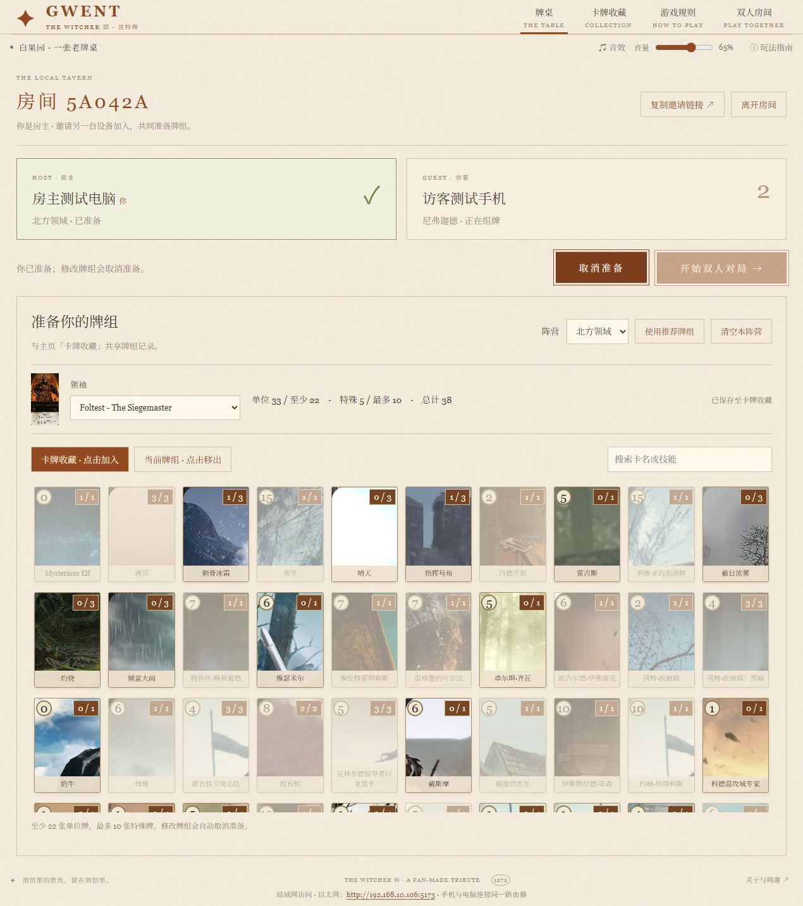
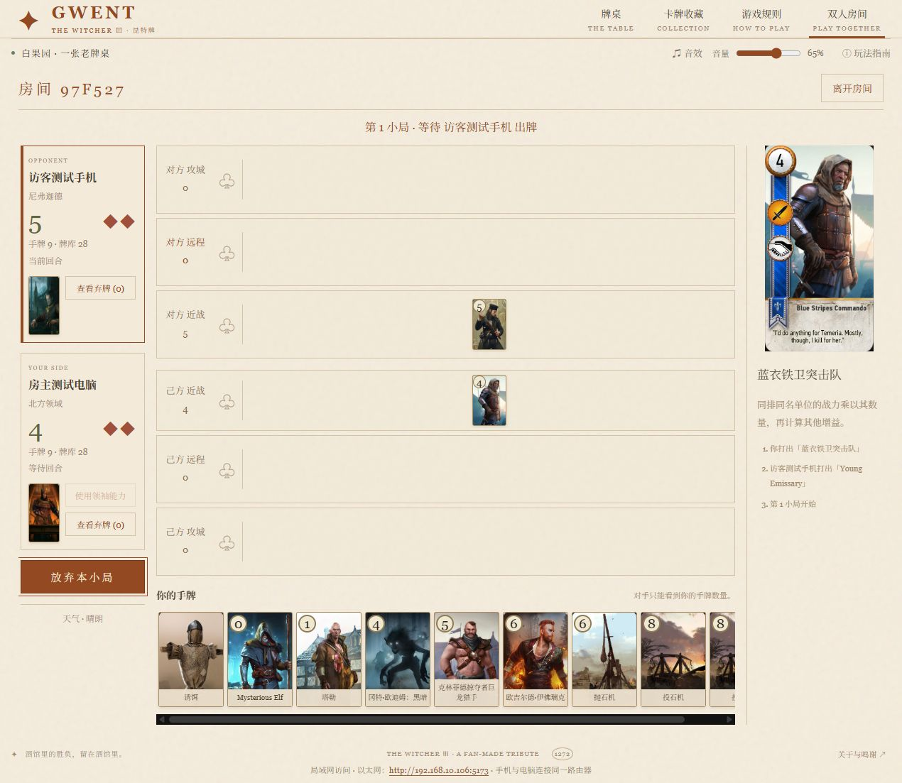

# 局域网双人模式

[返回 README](../README.md)

## 开房与加入

1. 房主在电脑运行 `start.cmd`、`sh start.sh` 或 `npm start`。
2. 打开游戏，点击「局域网双人 · 开房 / 加入」或导航栏「双人房间」。填写玩家名称，选择「创建房间」。
3. 点击「复制邀请链接」，交给连接同一路由器的朋友；也可让对方打开页脚的局域网地址，再填写六位房间号加入。
4. 双方选择阵营、领袖和卡牌，点击「准备完成」。只有双方在线且均已准备，房主才能点击「开始双人对局」。

每个房间两人，房号不区分字母大小写。首次使用的玩家名称从空牌组开始；可以逐张组牌，也可主动点击「使用推荐牌组」后修改。

## 牌组记录

| 玩家 | 保存位置与行为 |
| --- | --- |
| 房主 | 与当前浏览器、当前游戏地址的主页「卡牌收藏」共享五个阵营的牌组，房间中的修改也会写回收藏 |
| 访客 | 自动保存到房主电脑的 `.data/guest-decks.json`；按玩家名称记录，新名称初始为空，同名加入恢复五个阵营记录 |

玩家名称由玩家填写，名称前后空格会被忽略。同一房主电脑上的同名玩家共用一份牌组缓存，换设备、浏览器或访问地址后，输入相同名称即可恢复；不同名称的记录相互独立。同名记录以最近一次保存为准，同一房间内双方名称不能重复。

旧版按设备保存的记录会自动按名称读取；若同名有多份记录，使用更新时间最新的一份。首次保存新格式时，会把原文件保留为 `.data/guest-decks.json.v1.bak`。

修改阵营、领袖或任意卡牌会自动取消准备。准备时由服务器检查牌组：至少 22 张单位牌、最多 10 张特殊牌、有效领袖、正确阵营及合法卡牌数量。

访客记录保存在房主磁盘，重启服务后仍在；请保留 `.data/`。该目录已加入 `.gitignore`，不会随源码提交，也不能通过游戏 HTTP 服务读取。

## 对局操作与规则

双方采用与单机相同的规则、卡牌和技能代码，由真人取代电脑。

- 开局各抽 10 张牌，每人独立换牌，最多 2 张；双方完成后进入第一小局。
- 点击手牌查看说明，再点击高亮战斗排出牌。天气和灼烧通过详情中的按钮打出；诱饵需点击高亮的可收回单位。
- 使用领袖能力、医生复活、敏捷单位落排等操作时，由相应玩家完成选择。松鼠党的先手选择同样交给对应玩家。
- 双方都以己方在下、对手在上的视角看牌桌。对手的手牌和牌库内容不会传到本机；只能看到数量、领袖、战场和弃牌。查看三张手牌等技能仅向技能使用者显示相应内容。
- 双方放弃后按战力结算，生命宝石耗尽结束整场。结束后由房主返回组牌阶段，双方重新准备再战。

## 刷新、断线与结束

刷新页面或短暂断网后，使用相同浏览器和地址可自动回到原座位、恢复当前牌桌及未完成选择。服务器不会在玩家离线时替其出牌。

房主电脑和服务必须持续运行。房间及对局保存在服务内存中，停止或重启服务会关闭房间；重新开房后可继续使用已缓存的访客牌组。单机的暂离存档与房间对局相互独立。

点击「离开房间」会关闭整个房间并结束当前对局，页面会先提示确认。连接问题见[详细排障](troubleshooting.md#手机或其他设备打不开)。手机建议横屏；战场宽于屏幕时可横向滚动。
